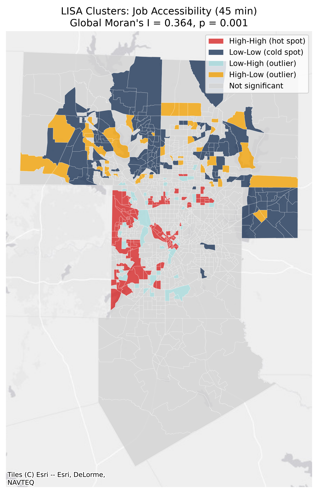
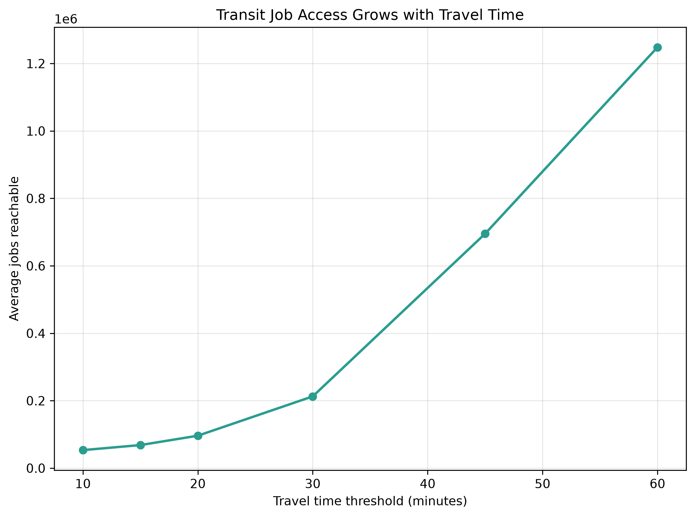
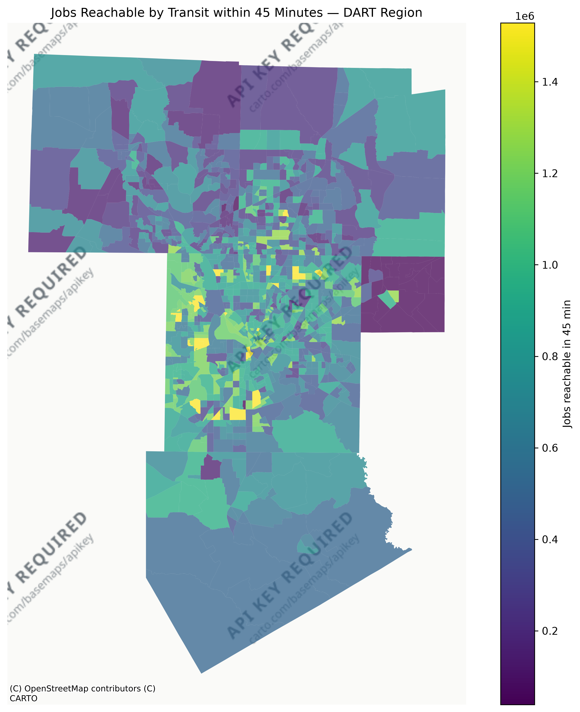
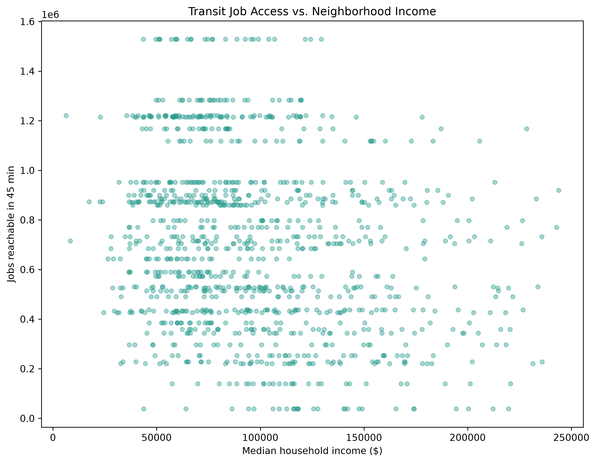
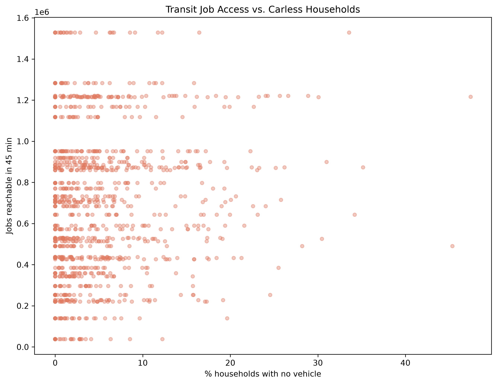
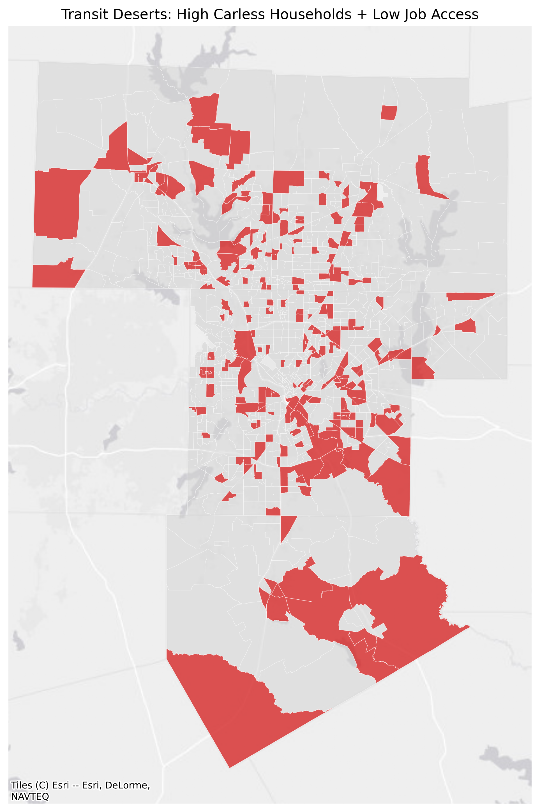

# Transit Job Accessibility in the Dallas Area

How many jobs can you actually reach by public transit from where you live? In this project, I measured transit job access for all 1,123 census tracts in the DART service region (Dallas, Collin, Denton, Rockwall, and Ellis counties) and explored how it changes with commute time, neighborhood income, and vehicle ownership.

*An independent project built during UT Dallas's Summer Program for Undergraduate Research (SPUR), with guidance from Prof. Alexander Michels.*

## Why this question

A job only counts as available to someone if they can get to it. For households without a car, that means transit, and how many jobs a transit trip can reach depends heavily on how long the person can afford to spend commuting. I wanted to quantify that, and to see whether access lines up with income or vehicle ownership and where it is spatially concentrated.

## What I built

I used r5py to compute transit travel-time isochrones from the centroid of each tract at six thresholds (10, 15, 20, 30, 45, and 60 minutes). The network combines the DART GTFS feed (bus, light rail, commuter rail, and streetcar) with an OpenStreetMap street network cropped to the DFW area. Prof. Michels ran the full routing job on UT Dallas's HPC cluster. From there I wrote the analysis in Python (pandas, GeoPandas, Shapely, PySAL, Matplotlib, contextily):

1. Filled each isochrone outline into a polygon.
2. Placed each tract's LEHD/LODES job count at its centroid and used a spatial join to sum the jobs inside each isochrone.
3. Merged the results with ACS income and vehicle-availability data.
4. Tested for spatial clustering with global and local Moran's I (LISA).

## What I found

### Job access depends heavily on how long you can commute

Average reachable jobs per tract stay low through 20 minutes, then rise sharply after 30. Every one of the 1,123 tracts reaches at least some jobs at every threshold, so the averages below cover the full region.

| Commute limit | Average jobs reachable |
|---|---|
| 10 min | 53,481 |
| 15 min | 68,448 |
| 20 min | 96,213 |
| 30 min | 212,838 |
| 45 min | 695,238 |
| 60 min | 1,248,230 |

A worker limited to a 30-minute commute can reach about 83% fewer jobs on average than one who can travel for 60 minutes. That matters because commute flexibility is often limited for caregivers and people working multiple jobs.

### Access varies a lot across the region

At 45 minutes, the median tract can reach about 705,000 jobs. A tract at the 90th percentile reaches about 4.8 times as many jobs as one at the 10th percentile (roughly 1.22 million vs. 253,000).

### Income and vehicle ownership were only weakly related to access

At 45 minutes, median income had a correlation of r = -0.24 with job access (1,101 tracts with income data), and the share of households without a vehicle had r = +0.12 (1,119 tracts). Both relationships are weak. One plausible explanation is that lower-income and carless households are concentrated in the denser urban core, where transit is strongest, while wealthier households are more often in car-oriented suburbs. I did not test this directly.

### Access is spatially clustered, and more so at longer commute limits

Global Moran's I is positive and significant (p = 0.001) at every threshold, and it grows as the commute limit grows. Local Moran's I (LISA) shows where the clusters are: at 45 minutes, high-access hot spots sit in central and western Dallas County, while low-access cold spots appear across Denton and Collin counties and in Rockwall County (map at the top of this page). Because the network includes DART service only, part of the low access in the northern counties may reflect limited DART coverage there rather than an absence of any transit.

| Commute limit | Global Moran's I | Low-access cold-spot tracts |
|---|---|---|
| 10 min | 0.176 | 95 |
| 15 min | 0.210 | 133 |
| 20 min | 0.223 | 163 |
| 30 min | 0.284 | 154 |
| 45 min | 0.364 | 149 |
| 60 min | 0.366 | 113 |

Cold spots are Low-Low LISA clusters at p < 0.05. Significance comes from a random permutation test, so the tract counts shift by a few between runs while Moran's I itself stays fixed. The rising Moran's I suggests that at short limits access is patchy and local, and at longer limits it follows a broader core-versus-edge pattern. I did not test that explanation.

### A simple screen flags 241 candidate transit deserts

I marked tracts with above-median carless households and below-median job access at 45 minutes. These 241 tracts (about 1 in 5) average 9.0% carless households, compared with 5.2% across the region. This is a threshold screen, not a statistical test, but it gives a first look at where transit-dependent residents might be underserved.

## Technical challenges

- **Java dependency:** r5py's routing engine requires a separate Java 21 installation.
- **Street network size:** r5py rejected the full Texas OpenStreetMap extract as too large, so I cropped it to the DFW area.
- **GTFS validation:** R5 flagged the 31-day-pass entries in DART's `fare_attributes.txt`, whose `transfer_duration` of 2,678,400 seconds is above the 86,400-second maximum it accepts. Fares don't affect travel time, so I built the network with `allow_errors=True` to skip these warnings.
- **Compute time:** Routing from 1,123 origins at six thresholds was too slow for a laptop, so Prof. Michels ran it on the university's HPC cluster. I tested the pipeline on a 5-tract sample first.

## Limitations and next steps

This is an exploratory analysis, and this is where I paused it. Things I would address next:

- **Transit-desert definition.** The median cutoffs are arbitrary, and different cutoffs would flag different tracts. LISA was run on job access alone, so a bivariate version (access and vehicle ownership together) would be a more rigorous test.
- **Why the cold spots are cold.** I did not check whether low-access tracts lack nearby transit stops, or compare their income and demographics to the rest of the region.
- **DART-only network.** Only DART service is modeled. Other agencies in the region, such as Trinity Metro and DCTA, are not included, which affects tracts near the edges of DART's service area.
- **Access metric.** Counting jobs inside a single time cutoff is coarse. A gravity-based measure such as 2SFCA would handle distance more carefully.
- **Spatial resolution.** Jobs and origins are placed at tract centroids, which creates the horizontal banding visible in the scatterplots.
- **Time of day.** Each isochrone uses a single departure time, so evening and weekend service is not captured.
- **Data vintage and uncertainty.** Jobs and ACS data are from 2023, while the GTFS schedule is from June 2026. ACS figures are estimates with margins of error, and 22 tracts have no income estimate.

## Data

| Data | Source |
|---|---|
| Employment | LEHD/LODES 2023 Workplace Area Characteristics (WAC), Texas, all jobs, rolled up from blocks to tracts |
| Transit network | DART GTFS feed, version V697-215-214-20260608 (valid June 8 to July 19, 2026) |
| Street network | OpenStreetMap, DFW extract |
| Median household income | American Community Survey, 2023, table B19013 |
| Vehicle availability | American Community Survey, 2023, table B08201 |
| Tract boundaries | U.S. Census Bureau TIGER/Line 2025, Texas tracts |

Raw data is not included because of file size.

## Running the code

Install `pandas`, `numpy`, `geopandas`, `shapely`, `matplotlib`, `contextily`, `libpysal`, `esda`, and `jupyter`. To regenerate the isochrones from scratch you also need `r5py` and Java 21. Download the datasets above into `gtfs/`, `lodes/`, `census/`, `shapefiles/`, and `osm/`, then run `transit_accessibility_analysis.ipynb` from top to bottom.

The isochrone cell in the notebook runs a 5-tract sample. The full run (`Isochrones-DFW.gpkg`) came from the HPC job and is not included in this repository.